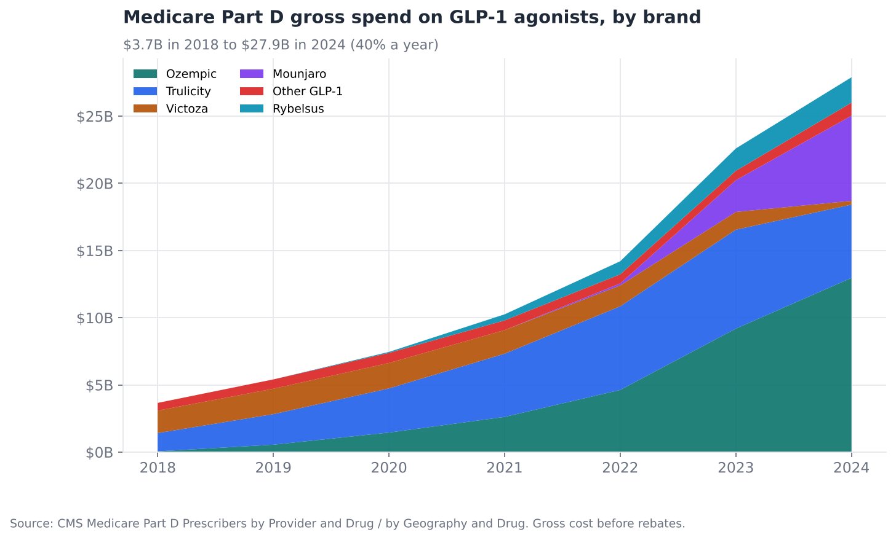
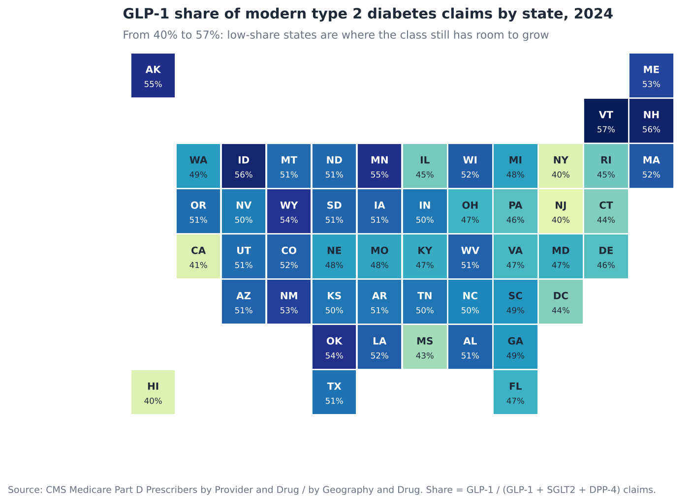
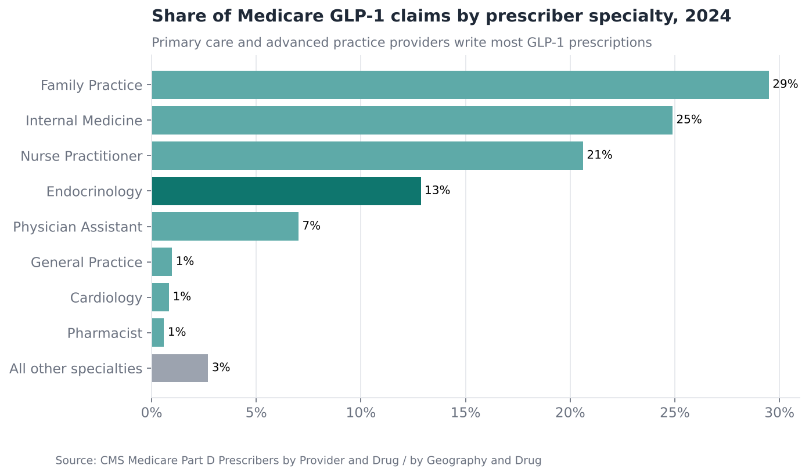
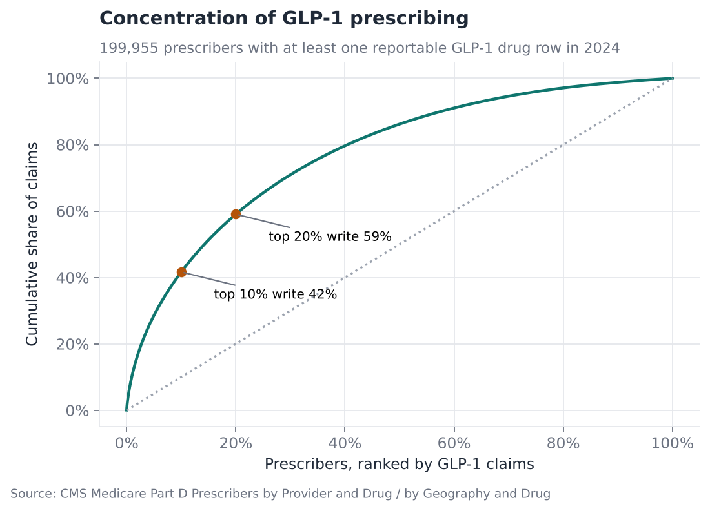
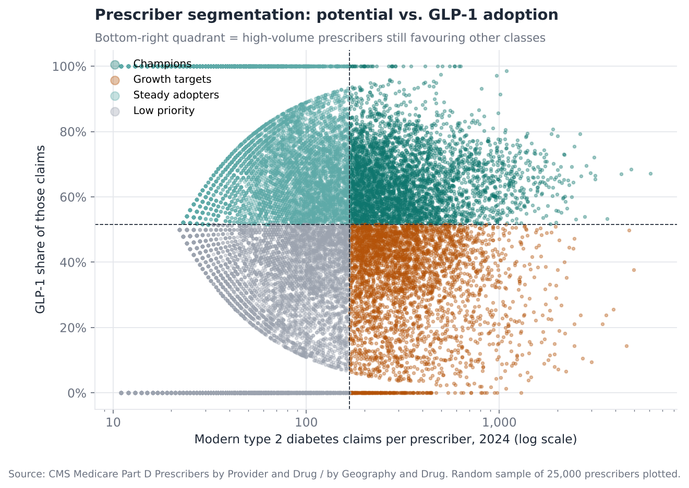
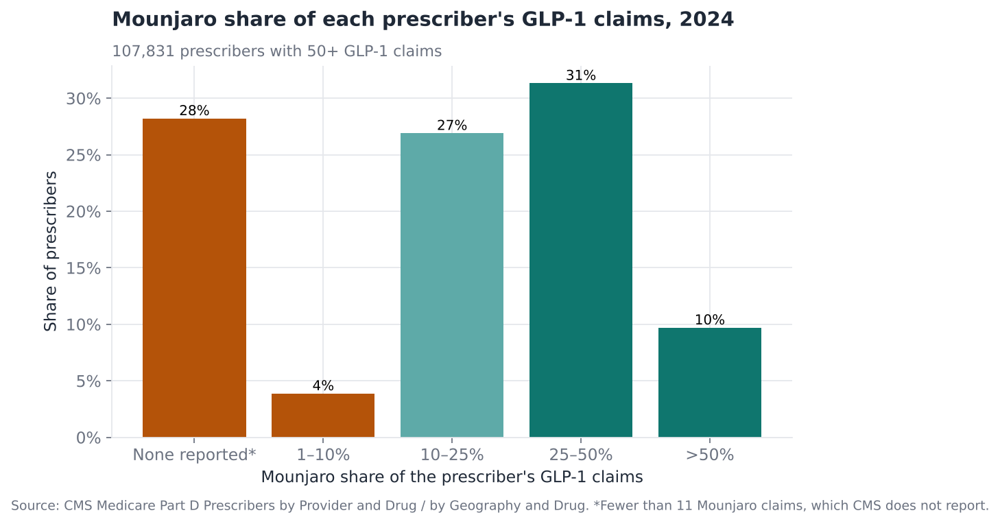

# GLP-1 Market Sizing and Prescriber Targeting in Medicare Part D

**Question:** A GLP-1 brand team has a fixed field force. Where is the remaining
growth in Medicare, and which prescribers should reps call on first?

**Answer in one line:** Medicare GLP-1 spend grew 40% a year to $27.9B in 2024,
but about 33,000 high-volume primary care prescribers still favour older
diabetes classes. Moving them to the adoption level of their peers is worth about
4 million extra claims a year, and half of that sits with just 6,700 prescribers.

[Full analysis notebook](analysis.ipynb) · [Source script](analysis.py) · [Target list (top 1,000)](outputs/tables/growth_target_list_top1000.csv)

---

## Data and method

- **CMS Medicare Part D Prescribers, by Provider and Drug (2022–2024):** one row
  per prescriber and drug. The extract covers 932,589 rows for GLP-1, SGLT2 and DPP-4 drugs in 2024.
- **CMS Medicare Part D Prescribers, by Geography and Drug (2018–2024):** national
  and state totals.
- **Segmentation** of 231,338 prescribers in diabetes-managing specialties, on two
  axes: *potential* (decile of total modern diabetes claims) and *adoption* (GLP-1
  share of those claims).
- **Opportunity sizing:** the extra GLP-1 claims if each under-adopting, high-volume
  prescriber reached the median adoption of high-volume peers.

**Terms:**
- **GLP-1 agonists**, such as Ozempic, Mounjaro, Trulicity and Rybelsus, lower blood
  sugar and weight.
- **SGLT2** (Jardiance, Farxiga) and **DPP-4** (Januvia, Tradjenta) inhibitors are the
  other modern, branded type 2 diabetes classes. Together the three are called
  "modern diabetes therapy" here.
- A **claim** is one prescription fill.
- **Gross cost** is the pharmacy price before manufacturer rebates.
- CMS hides any prescriber–drug count under 11 to protect privacy.

## Findings

### 1. The market: $27.9B and still compounding


- Medicare Part D GLP-1 gross spend rose from **$3.7B (2018) to $27.9B (2024)**, 40% a year.
- In 2024, Ozempic held 47% of class spend, Mounjaro 23% (in its second full
  year), Trulicity 20% and Rybelsus 7%.
- GLP-1 claims overtook DPP-4 inhibitors in 2022. By 2024 they reached 22.2M, against 18.4M for SGLT2 and 6.9M for DPP-4.

### 2. Large states are under-penetrated


GLP-1s take **40%** of modern diabetes claims in New York, New Jersey and Hawaii
and 41% in California, against **55–57%** in Vermont, New Hampshire, Idaho and
Minnesota. Some of the largest Medicare populations sit in the lowest-share
states, which is where class growth has the most room.

### 3. This is a primary-care market


Family practice, internal medicine and nurse practitioners write **75%** of
Medicare GLP-1 claims. Endocrinologists write 13%. The market is concentrated
nonetheless: the top 10% of prescribers write **42%** of claims, and the top 20% write 59%.



### 4. Four segments, one clear priority


| Segment | Prescribers | Share of modern diabetes claims | GLP-1 share | Action |
|---|---|---|---|---|
| Champions | 36,609 | 39% | 65% | Protect and retain |
| **Growth targets** | **32,793** | **34%** | **33%** | **First call priority** |
| Steady adopters | 79,060 | 14% | 74% | Digital / non-personal |
| Low priority | 82,876 | 13% | 25% | Non-personal only |

Growth targets write a third of all modern diabetes claims but give GLP-1s only
a third of them. Closing the gap to champions' median adoption (64%) is the
largest single source of growth.

### 5. Sizing the opportunity

| Measure | Value |
|---|---|
| Extra GLP-1 claims a year, if growth targets reach the champion median | **4.0 million** |
| Value at 2024 average gross cost per claim ($1,253) | **≈$5.0B gross** |
| Prescribers holding half of that opportunity | **6,738** |
| Specialty mix of the opportunity | internal medicine 43%, family practice 31%, NPs 14%, endocrinology 4% |

Growth in 2024 (+39% claims) came mostly from deeper use by **existing**
prescribers (84% of the increase), not from new prescribers. That supports
depth-focused targeting over broad awareness.

### 6. Brand lens: where Mounjaro is under-indexed


Among 107,831 prescribers with 50+ GLP-1 claims, **28%** had too few Mounjaro
claims for CMS to report (under 11), and another 4% gave it 10% or less. For a
Mounjaro team these established GLP-1 prescribers are switch targets: they already
believe in the class, so the job is brand preference, not class education.

## Recommendations

1. **Re-weight field effort to primary care.** Put the first wave of rep calls on the
   6,738 highest-opportunity growth targets ([list](outputs/tables/growth_target_list_top1000.csv)).
   They are mostly internal medicine and family practice, not endocrinology.
2. **Weight territory investment towards New York, New Jersey and California.**
   They combine large Medicare populations with the lowest GLP-1 penetration.
3. **Move steady and low-priority segments to non-personal channels** (email,
   virtual detailing, peer programmes) to free rep capacity. Together they are
   70% of prescribers but only 27% of claims.
4. **Run two playbooks:** class conversion for growth targets, and brand switching
   for high-GLP-1 prescribers who rarely write your brand.
5. **Treat cardiologists and nephrologists as a separate audience** for the
   cardiovascular and kidney indications. Their low GLP-1 share reflects
   heart-failure and kidney use of SGLT2s, not under-use in diabetes.

## Limitations

- Medicare Part D only (people 65+ and some disabled people). Commercial and
  Medicaid patterns differ, and Part D does not cover drugs used only for weight
  loss, so Wegovy and Zepbound barely appear.
- CMS suppresses counts under 11, so low-volume prescribers and small brand shares are
  undercounted.
- Gross cost is before rebates, which are substantial for this class. The $5.0B figure
  sizes the opportunity; it is not net revenue.
- 2024 is the latest year CMS has published at prescriber level.

## Reproduce

```bash
python 01-glp1-market-and-targeting/fetch_data.py   # streams about 10 GB of CMS CSVs; about 30 minutes
python -m common.build_notebooks 01-glp1-market-and-targeting
```
