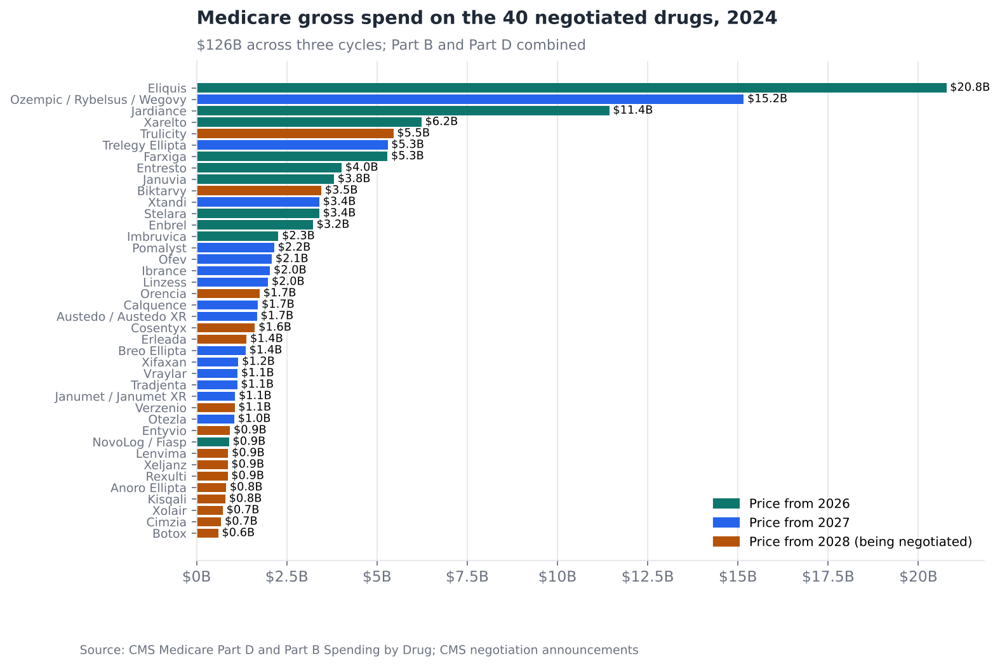
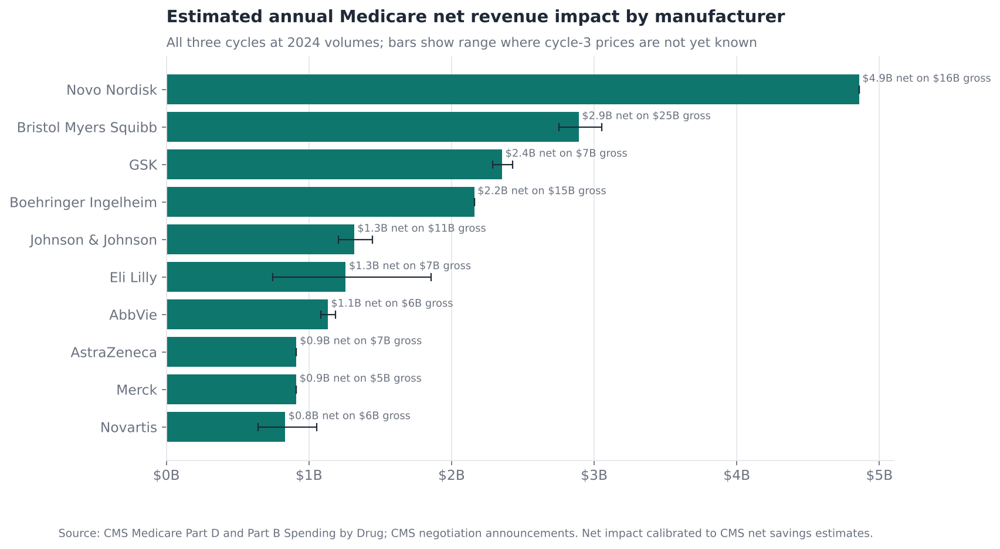
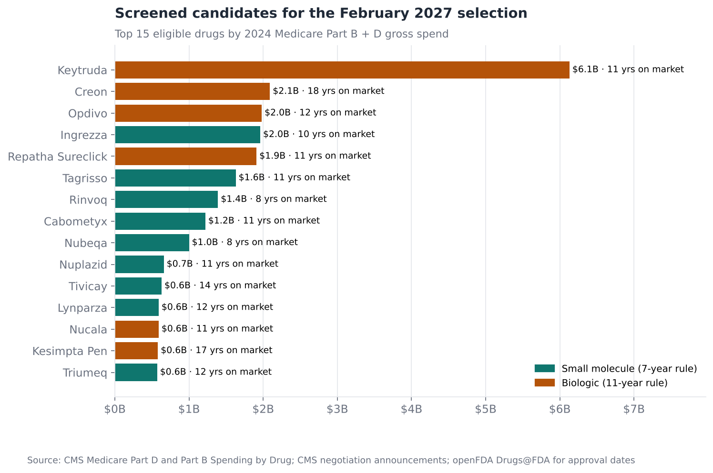

# Medicare Price Negotiation: Who Is Exposed, and Who Is Next?

**Question:** The Inflation Reduction Act (IRA) lets Medicare set a "maximum fair
price" for high-spend drugs. How much Medicare revenue is already covered by
negotiated prices, which manufacturers carry the most, and which drugs are likely
to be picked in the next selection in February 2027?

**Answer in one line:** The 40 drugs selected so far took $126B of Medicare
spend in 2024, and their negotiated prices cost manufacturers an estimated
**$21–25B a year** in net revenue. Novo Nordisk is the most exposed. Keytruda
heads a screened list of next candidates, and the screen picked 11 of 15 actual
selections in back-tests.

[Full analysis notebook](analysis.ipynb) · [Source script](analysis.py) · [Selected-drug reference table](negotiation_lists.py)

---

## Data and method

- **CMS Medicare Part D and Part B Spending by Drug (2020–2024):** gross spend by brand
  and, for Part D, by manufacturer. 2024 totals were $289B for Part D and $53B for Part B.
- **CMS negotiation announcements:** the 40 selected drugs, the 25 negotiated
  prices published so far, and CMS's own net-savings estimates.
- **openFDA Drugs@FDA:** first approval date and application type for the top 300
  Medicare drugs.

**Terms:**
- **Part D** covers pharmacy drugs. **Part B** covers drugs given in a clinic or
  hospital outpatient setting.
- **IPAY** (initial price applicability year) is the year a negotiated price takes effect.
- **List price vs. net price:** list price is the published price. Net price is
  what the manufacturer keeps after rebates. CMS publishes negotiated prices
  against list price, but rebates on many of these drugs were already large.

### Turning headline discounts into net impact

CMS's published list-price cuts range from 38% to 85%. Revenue loss is far
smaller, because many of these drugs already carried heavy rebates. The analysis
anchors to CMS's own net-savings estimates:

| Cycle | Gross Part D cost (base year) | CMS estimated net savings |
|---|---|---|
| IPAY 2026, 10 drugs | $56.2B (2023) | about $6B, 22% of net spend |
| IPAY 2027, 15 drugs | $42.5B (2024) | about $12B, 44% of net spend |

Each cycle's savings are shared out across its drugs in proportion to *gross
spend × list-price discount*. For the third cycle (prices due by November 30,
2026), the range of net-impact ratios from the first two cycles is used.

## Findings

### 1. A fifth of Part D is already under negotiated prices


| Cycle | Drugs | 2024 Medicare gross spend | Share of Part D |
|---|---|---|---|
| Prices from 2026 | 10 | $61.4B | 21% |
| Prices from 2027 | 15 | $42.4B | 15% |
| Prices from 2028 | 15 | $21.9B (incl. $3.0B Part B) | 7% |

### 2. Net impact is concentrated in a few companies


| Manufacturer | Estimated annual net impact | Main drugs |
|---|---|---|
| Novo Nordisk | **$4.9B** | Ozempic / Rybelsus / Wegovy, NovoLog |
| Bristol Myers Squibb* | $2.9B | Eliquis, Orencia, Pomalyst |
| GSK | $2.4B | Trelegy, Breo, Anoro |
| Boehringer Ingelheim* | $2.2B | Jardiance, Ofev, Tradjenta |
| Johnson & Johnson | $1.3B | Xarelto, Stelara, Erleada |

\*CMS data assign alliance products to one labeler. Eliquis profits are shared
with Pfizer, and Jardiance and Tradjenta with Eli Lilly.

The semaglutide franchise alone accounts for about $4.7B. It was the largest
single drug in the second cycle, at a 71% list-price cut, and its Medicare volume
is still growing.

### 3. A transparent screen can shortlist the next selection
Before forecasting, the screen was back-tested on both completed selections,
using only information available at the time:

| Selection | Drugs selected by CMS | Picked by the screen's top 15 |
|---|---|---|
| IPAY 2027 (Jan 2025, Part D) | 15 | **11** |
| IPAY 2028 (Jan 2026, Part B + D) | 15 | **11** |

The screen's rules: group brands by active ingredient; require 7 years on market
(small molecules) or 11 (biologics); exclude drugs with a marketed generic in
CMS claims data, marketed biosimilars, orphan-only drugs and drugs already
selected; then rank by spend. The misses mostly reflect CMS's November–October
spend window and case-by-case exclusions.

### 4. Likely candidates for February 2027 (IPAY 2029)


The top of the list:
- **Keytruda** and **Opdivo:** passed over in the January 2026 selection because
  their first approvals were for rare cancers. Under the July 2025 orphan-drug change, their clocks run from
  their first lung-cancer approvals (October and March 2015), which makes both
  eligible in 2027.
- **Ingrezza:** protected so far by the small-biotech exception, which applies
  only to the first three cycles.
- **Repatha** reaches its 11-year mark in August 2026. Tagrisso, Rinvoq,
  Cabometyx and Nubeqa follow.

## Recommendations

**For market access and finance teams at the exposed companies:**
1. Model negotiated prices at **net**, not list. On these drugs, list-price
   cuts of 38–85% translate into losses of roughly 5–35% of Medicare gross spend.
2. Expect Medicare volume shifts after MFP effective dates. Plans have less
   reason to put rival brands ahead of a negotiated drug, which can partly
   offset the price loss.

**For companies with drugs on the watchlist:**
1. Start MFP scenario planning now. Under the statute, selection announced
   February 2027 leads to prices effective January 2029.
2. Check the orphan-clock and biosimilar-timing arguments, which is where
   eligibility is most often contested.
3. Weigh lifecycle choices against the clock, such as reformulations, new
   indications and launch timing for line extensions. CMS groups all forms of an
   active ingredient, so new forms do not reset it.

## Limitations

- Medicare gross spend is before rebates. Net impact relies on CMS's aggregate
  estimates and assumes similar rebate depth within each cycle.
- 2024 calendar-year spend is used; CMS selects on a November–October window.
- Orphan status, biosimilar presence and small-biotech status are hand-coded for
  known cases and are not exhaustive. Several oncology entries on the watchlist
  need an orphan review before being treated as firm candidates.
- Third-cycle (IPAY 2028) impacts are ranges until CMS publishes those prices.

## Reproduce

```bash
python -m common.fetch_shared                         # CMS spending files
python 02-ira-negotiation-exposure/fetch_data.py      # openFDA lookups, about 5 minutes
python -m common.build_notebooks 02-ira-negotiation-exposure
```
