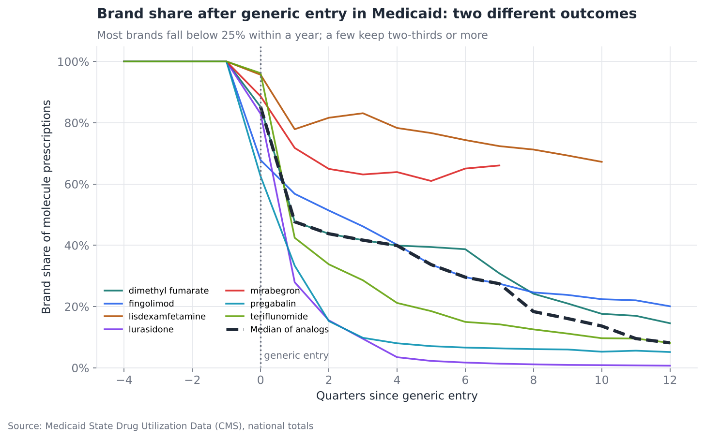
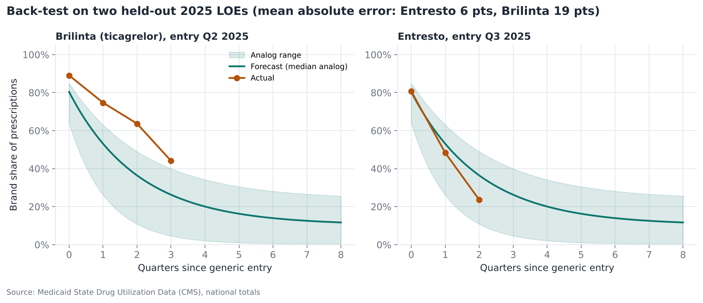
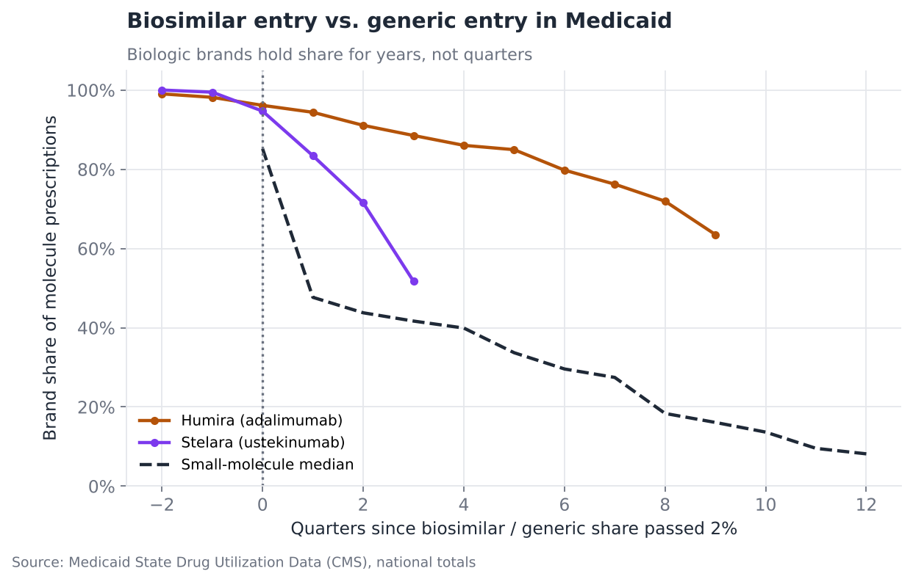
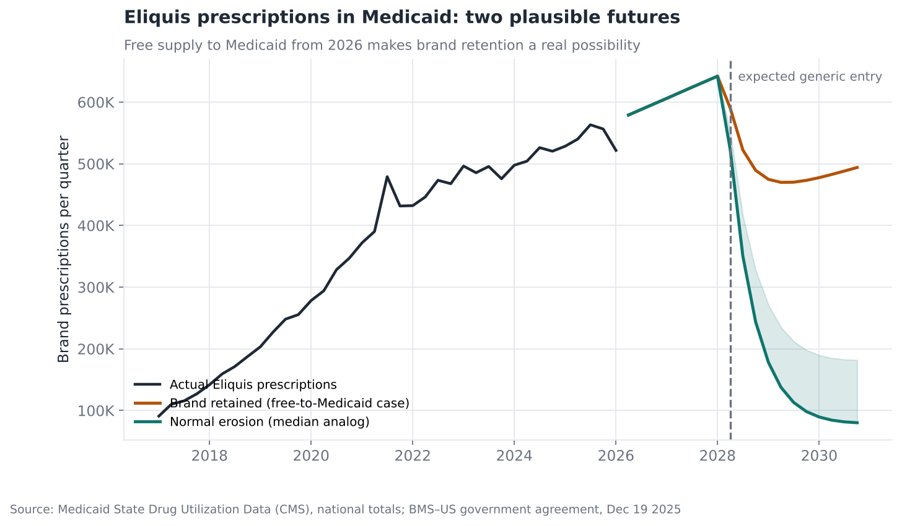

# Loss of Exclusivity: How Fast Brands Erode, and What Happens to Eliquis in 2028

**Question:** When a brand loses exclusivity, how quickly does it lose volume,
and can an analog-based forecast be trusted? Then apply the answer to the largest
upcoming case: Eliquis (apixaban), expected to face US generics from April 2028.

**Answer in one line:** In Medicaid most small-molecule brands keep only about a
fifth of prescriptions a year after generic entry, but some keep two-thirds. A
December 2025 deal that makes Eliquis free to Medicaid puts it on course for the
second path.

[Full analysis notebook](analysis.ipynb) · [Source script](analysis.py)

---

## Data and method

- **Medicaid State Drug Utilization Data (SDUD), 2017 to Q1 2026:** quarterly
  prescriptions and reimbursement for every drug product Medicaid paid for.
  National totals are used. Brand and generic versions of a molecule appear under
  different product names, so brand share can be measured directly.
- **Entry quarter** = the first quarter in which generics or biosimilars took at
  least 2% of a molecule's prescriptions. It is derived from the data, then
  checked against public launch dates:

| Molecule (brand) | Entry quarter in data | Public first generic launch |
|---|---|---|
| pregabalin (Lyrica) | 2019 Q3 | July 2019 |
| dimethyl fumarate (Tecfidera) | 2020 Q3 | August 2020 |
| fingolimod (Gilenya) | 2022 Q4 | late 2022 |
| lurasidone (Latuda) | 2023 Q1 | February 2023 |
| teriflunomide (Aubagio) | 2023 Q1 | March 2023 |
| lisdexamfetamine (Vyvanse) | 2023 Q3 | August 2023 |
| mirabegron (Myrbetriq) | 2024 Q2 | April 2024 |
| ticagrelor (Brilinta) | 2025 Q2 | May 1, 2025 |
| sacubitril/valsartan (Entresto) | 2025 Q3 | July 22, 2025 |

- **Erosion model:** for each analog, brand share after entry is fitted as
  `floor + (1 − floor) · e^(−k·(t + 0.5))`. Here *k* is the speed of loss and
  *floor* is the share the brand keeps long-term.
- **Validation:** Brilinta and Entresto (2025 LOEs) were held out and forecast
  using only the older analogs.
- **Excluded:** Chantix, because its 2021 collapse was a product recall, not
  competition. Xarelto, because only one strength has gone generic so far.

**Terms:** *LOE* (loss of exclusivity) is when patents and regulatory
exclusivity end. *Biosimilars* are near-copies of biologic drugs. A state's
*preferred drug list (PDL)* steers Medicaid prescriptions to the product that
is cheapest for the state after rebates.

## Findings

### 1. Two different outcomes, not one average curve


| | Brands | Brand share 4 quarters after entry |
|---|---|---|
| **Normal erosion** | Lyrica, Latuda, Aubagio, Tecfidera, Gilenya | 4%–40% (median **21%**) |
| **Brand retained** | Vyvanse, Myrbetriq | **64%–78%** |

Brands are retained when the brand stays cheaper to the state than early
generics after Medicaid rebates, so state PDLs keep it preferred. For Vyvanse
the 2023–24 ADHD stimulant shortage also limited generic supply. A forecast that
averages the two groups is wrong for both.

### 2. The back-test: good on Entresto, too fast on Brilinta


| Held-out LOE | Quarters tested | Mean absolute error |
|---|---|---|
| Entresto | 3 | **6 share points** |
| Brilinta | 4 | **19 share points** (eroded more slowly than any training analog) |

Six companies launched generic Brilinta 90 mg on the first day, so the slow decline
reflects factors the public data cannot show, such as PDL status and brand
contracting. The practical lesson is that errors of 10–20 points at quarter level
are normal. Plan on a range, and use the first two post-entry quarters to tell
which regime a brand is in.

### 3. Biologics erode in years, not quarters


Two years after biosimilars passed 2% of prescriptions, Humira still held about
**72%** of Medicaid adalimumab prescriptions. Stelara held 72% after two
quarters, against well under half for a typical small molecule.

### 4. Eliquis: the free-to-Medicaid twist


On **December 19, 2025** Bristol Myers Squibb agreed with the US government to
supply Eliquis to Medicaid **free of charge from January 1, 2026**. The data
already show it: Medicaid reimbursement per Eliquis prescription fell from
**$653 in Q4 2025 to $421 in Q1 2026**, while volume barely moved (about 2.2
million prescriptions in 2025).

No generic can undercut a free brand on net cost, so states have every reason to
keep Eliquis preferred after April 2028.

| Eliquis Medicaid prescriptions, 2029 | Scenario |
|---|---|
| ~0.5 million | Normal erosion (median analog) |
| ~0.9 million | Normal erosion (slow analog) |
| **~1.9 million** | Brand retained (free-supply terms continue) |

## Recommendations

- **Generic apixaban makers:** Treat Medicaid's roughly 2 million annual
  prescriptions as upside, not base case, unless the free-supply terms are known
  to end before 2028. Size launch volumes on commercial and Medicare.
- **BMS / Pfizer:** Medicaid is now a non-revenue, brand-loyal channel. The 2028
  revenue cliff will come from commercial and Medicare, and Medicare already pays
  the negotiated price from 2026 (see [project 02](../02-ira-negotiation-exposure/)).
- **Any LOE forecast:** Decide which regime applies before choosing a curve. Look
  at state PDL decisions in the first two quarters, and the brand's Medicaid rebate
  position relative to the number of generic entrants.

## Limitations

- Medicaid is a minority of US prescriptions and behaves differently
  from commercial insurance, because of rebates and PDLs. These curves should not be used
  unchanged for commercial forecasts.
- SDUD reimbursement is before rebates. It shows what pharmacies were paid, not
  manufacturer revenue.
- The latest quarter (Q1 2026) may still be incomplete because of claims lag, so it
  is excluded from the Eliquis trend.

## Reproduce

```bash
python 03-loe-erosion-forecast/fetch_data.py   # streams about 5 GB of public CSVs; about 10 minutes
python -m common.build_notebooks 03-loe-erosion-forecast
```
