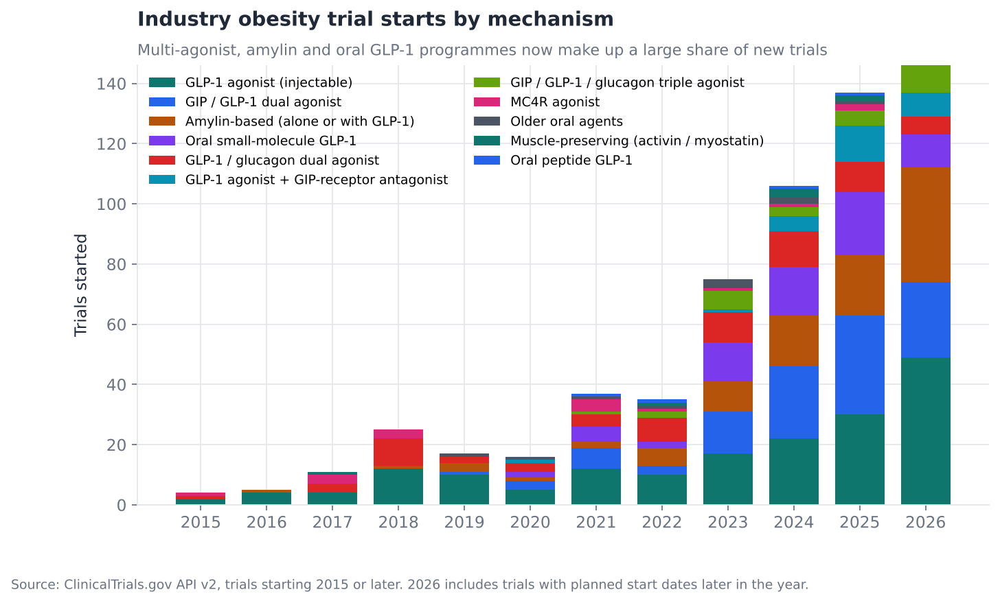
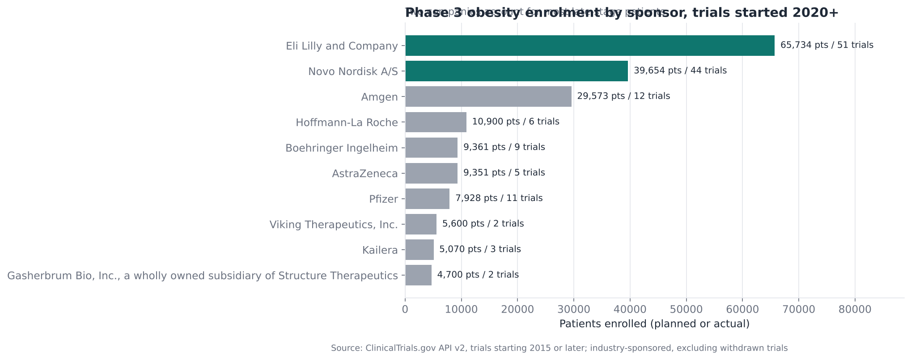
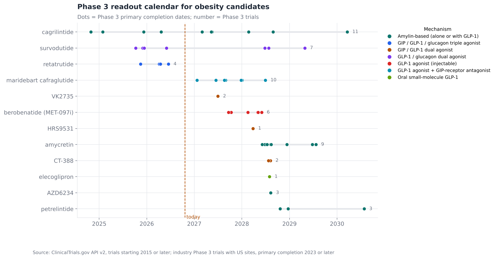
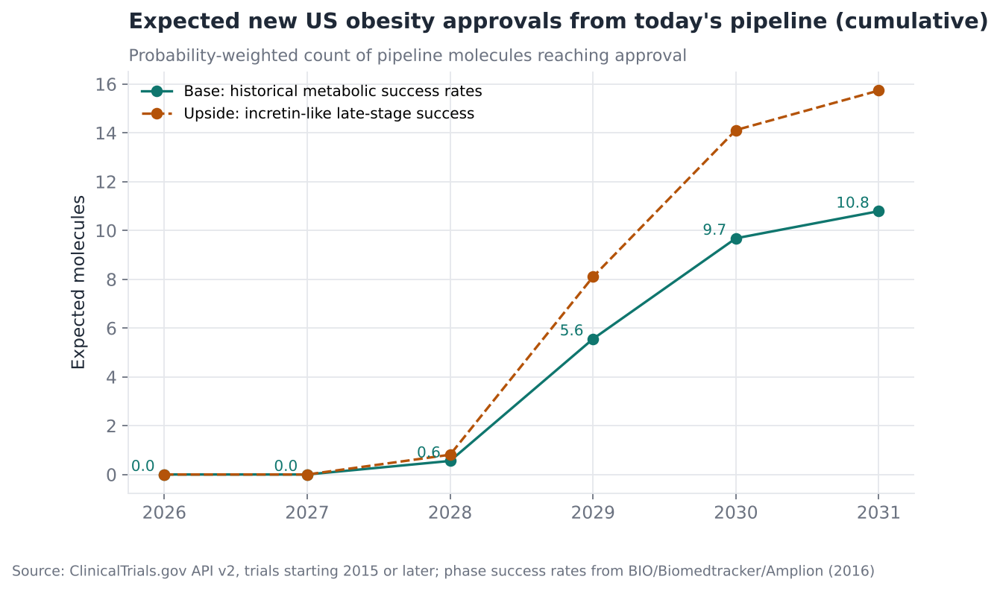
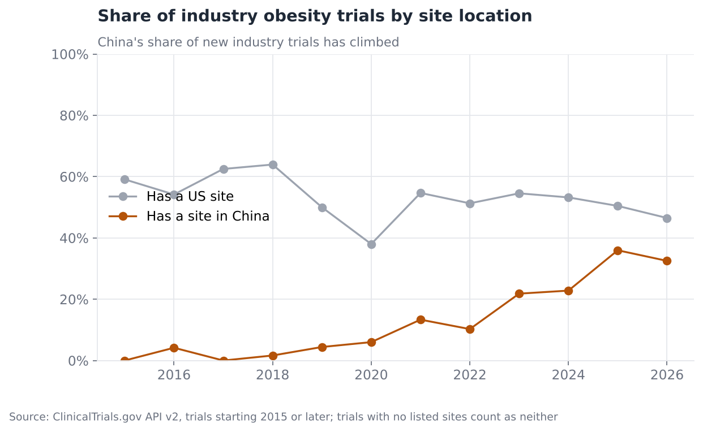
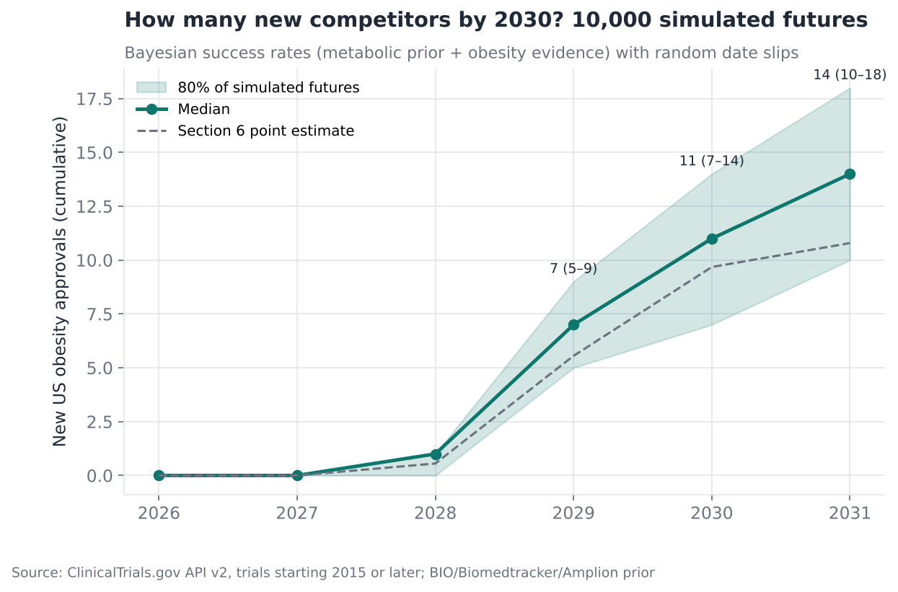

# Obesity Drug Pipeline: Competitive Intelligence

**Question:** Who will be competing in the US obesity market by 2030, with which
mechanisms, and when do the readouts that decide it land?

**Answer in one line:** About ten new molecules can be expected to reach US
approval by 2030, almost all arriving in 2029–2030. Competition is shifting
from "which GLP-1" to amylin combinations, multi-agonists and oral pills, and a
growing share of the pipeline is being developed in China first.

[Full analysis notebook](analysis.ipynb) · [Source script](analysis.py) · [Molecule reference table](molecules.py)

---

## Data and method

- **ClinicalTrials.gov API v2:** all 8,311 interventional trials for obesity or
  overweight starting from 2015 onward, 1,300 of them industry-sponsored.
- **Molecule mapping:** trial interventions are free text ("LY3437943",
  "Retatrutide 12 mg"). [`molecules.py`](molecules.py) maps sponsor code numbers and
  names to 47 named molecules and 11 mechanism classes. Unseen molecules are picked up
  through WHO naming stems; for example, *-glipron* marks a small-molecule GLP-1
  agonist and *-lintide* an amylin analogue.
- **US staging:** each molecule is staged by its most advanced trial **with US
  sites**. A drug in Phase 3 in China but Phase 2 in the US counts as Phase 2 for
  the US question.
- **Launch expectation:** historical phase-success rates for metabolic drugs
  (BIO / Biomedtracker / Amplion, *Clinical Development Success Rates 2006–2015*)
  give each molecule a probability of approval. Timing is set at about 16 months
  after its last US Phase 3 primary completion (filing plus a standard FDA review).

**Terms:** *GLP-1, GIP, glucagon and amylin* are gut and pancreatic hormones;
drugs that mimic them reduce appetite and weight. *Dual* and *triple agonists*
activate two or three of these receptors with one molecule. *Primary completion*
is when the last patient gives data for the main endpoint, which is the earliest
point a topline result can be announced.

## Findings

### 1. Investment has moved beyond single GLP-1 agonists


Industry obesity trial starts went from fewer than 25 a year before 2020 to more
than 130 a year from 2025. In 2025, GIP/GLP-1 dual agonists, amylin-based drugs
and oral small-molecule GLP-1s made up more than half of new starts.

### 2. Two companies run half of late-stage obesity development


Lilly and Novo Nordisk account for **48%** of patients in industry Phase 3
obesity trials started since 2020. Amgen (MariTide) is a clear third. Roche,
Boehringer, AstraZeneca and Pfizer each run programmes of roughly 8,000–11,000 patients.

### 3. The readout calendar: 2027–2028 is the crunch


There are 14 molecules in development with US Phase 3 trials. Most of their primary
completions fall between mid-2027 and late 2028: MariTide, berobenatide
(Pfizer, from Metsera), Lilly's amylin agonist eloralintide, AstraZeneca's oral
elecoglipron and AZD6234, Roche's CT-388 and Hengrui/Kailera's HRS9531.

### 4. Expect about ten new US approvals by 2030


| Scenario | Assumption | Expected new molecules approved by 2030 |
|---|---|---|
| Base | Historical metabolic success rates | **9.7** |
| Upside | 90% success from Phase 3 on, as incretins have mostly achieved | **14.1** |

Almost nothing new arrives before 2029. That gives the current leaders
(Wegovy, Zepbound, and the two oral GLP-1s approved in December 2025 and April
2026) about two more years before the field gets crowded.

### 5. China is now a source of the pipeline, not just a market


The share of new industry obesity trials with a site in China rose from about **0% in
2015 to 36% in 2025**. Eight molecules are in Phase 3 outside the US but not yet
in US Phase 3, including mazdutide (Innovent), ecnoglutide (Sciwind), bofanglutide
(Gan & Lee) and UBT251 (licensed to Novo Nordisk). Several have already been
licensed by Western companies, and the rest are natural targets.

### 6. Advanced analytics extension: Bayesian success rates and 10,000 simulated futures


The point estimate in section 4 becomes a full range:

1. **Bayesian updating:** the industry-wide metabolic success rates are the
   prior. The obesity programmes in the data then update them: 9 of 13 molecules
   moved from Phase 2 to Phase 3, and 5 reached approval with no Phase 3
   discontinuations. That lifts Phase 2→3 from 45% to **59%**, and Phase 3→approval
   from 56% to **70%**.
2. **Monte Carlo simulation:** 10,000 runs in which each molecule succeeds or
   fails at those rates and its date slips at random.

| By end-2030 | Result |
|---|---|
| New US obesity approvals, median (80% range) | **11 (7–14)** |
| Chance of at least 5 new approvals | 98% |
| Chance of at least 10 | 65% |
| Chance at least one new **amylin-based** drug is approved | 97% |
| … at least one new **oral small-molecule GLP-1** | 92% |
| … at least one **muscle-preserving** drug | 40% |

The obesity evidence leans optimistic: the class has been unusually
successful, and failed programmes are under-registered. The prior limits
that, but the range should be read as optimistic-leaning.

**A documented negative result:** a text classifier (TF-IDF with logistic
regression) was trained to infer a drug's mechanism from trial titles and
summaries for the 40% of code numbers that could not be mapped. On molecules it had not seen it
scored 15% accuracy, below the 25% from always guessing the commonest
mechanism. Registry text rarely names the mechanism, so mapping new codes still
needs curated sources. The attempt is kept in the notebook so the conclusion can
be checked.

## Recommendations

**For a challenger without an obesity asset (business development):**
1. Buy or license now rather than build. The window before 2029 launches is
   when differentiated assets are still affordable. China-first programmes with
   Phase 3 data are the most capital-efficient route to a late-stage asset.
2. Do not compete on weight-loss percentage alone; the leaders will win that.
   The open niches are **tolerability** (amylin-based drugs), **convenience**
   (monthly dosing, oral pills) and **body composition** (muscle-preserving
   antibodies such as bimagrumab, so far only in Phase 2).

**For an incumbent brand team:**
1. Use 2026–2028 to lock in payer coverage and long-term persistence before
   2029 brings price pressure from several new entrants at once.
2. Track the readouts in the calendar above as the main triggers for revising
   competitive assumptions.

## Limitations

- ClinicalTrials.gov dates are sponsor estimates and often slip. Completed trials
  show actual dates.
- About 40% of industry trials that test a drug use code numbers that could not be
  confidently mapped. They are listed in the notebook and are mostly early-stage,
  China-origin assets. They are left unclassified rather than guessed.
- Phase-success rates are averages for metabolic drugs. Incretin-based drugs
  have done better, which is why an upside case is shown.
- Approval status is as of October 2026 (oral semaglutide 25 mg approved December
  22, 2025; orforglipron approved April 2026).

## Reproduce

```bash
python 04-obesity-pipeline-intelligence/fetch_data.py   # about 1 minute
python -m common.build_notebooks 04-obesity-pipeline-intelligence
```
