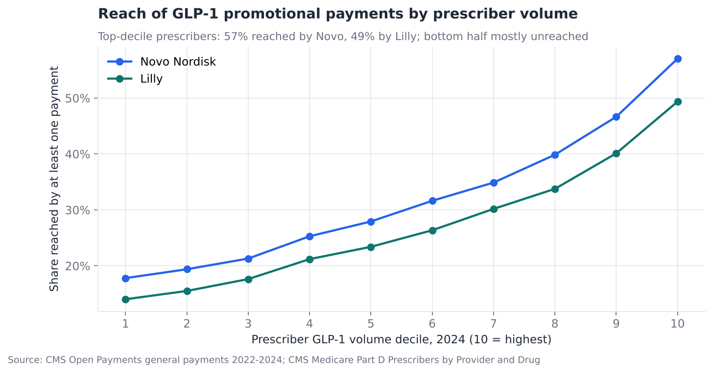
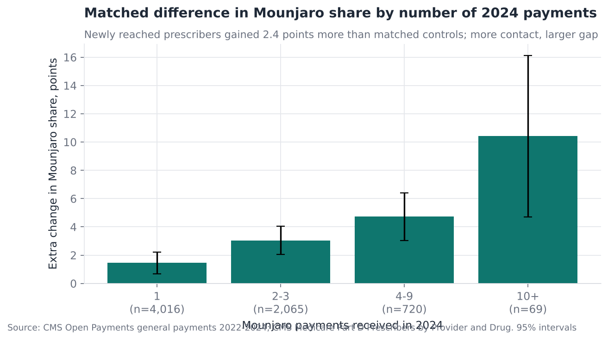
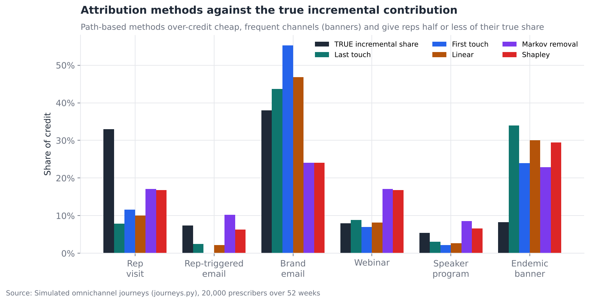
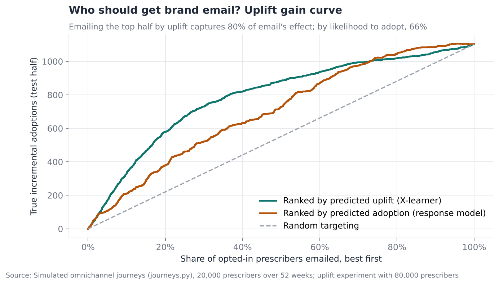
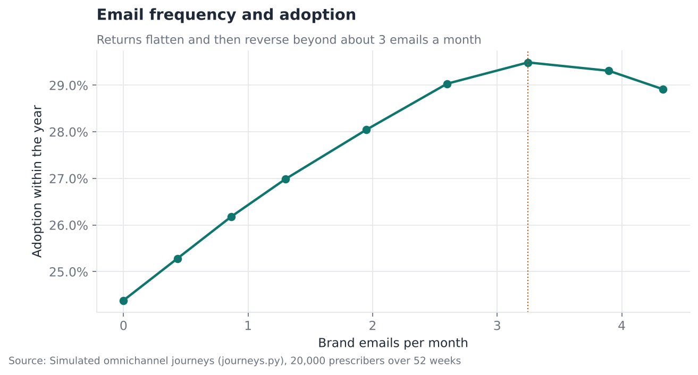
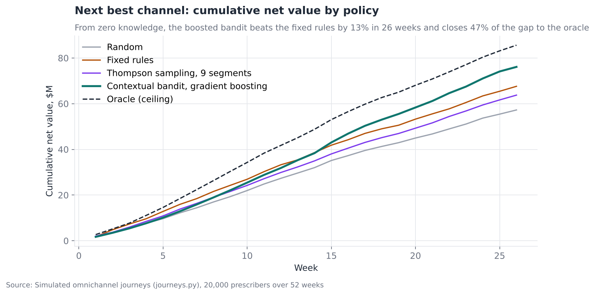

# Omnichannel HCP Engagement: What Promotion Reaches, What It Moves, and What to Send Next

**Questions:** Do diabetes and obesity brands point their personal promotion at
the prescribers who matter? Does promotion line up with prescribing once like
is compared with like? And across all channels, which attribution, targeting
and next-best-action methods actually get the right answer?

**Answer in one line:** Even the most active brand reaches only 57% of the
top-decile GLP-1 prescribers, and every common attribution method misplaces
about 30% of the credit. Uplift targeting and a learning next-best-channel
policy both beat the rules a brand team would write by hand.

[Full analysis notebook](analysis.ipynb) · [Source script](analysis.py) · [Simulation](journeys.py) · [Briefs](outputs/briefs/)

---

## Data

| Source | What it gives | Real or simulated |
|---|---|---|
| CMS Open Payments, general payments 2022–2024 | Every meal, speaker fee, consulting fee and travel payment linked to a GLP-1, SGLT2 or DPP-4 brand: 3.4 million records, $166M | Real |
| CMS Medicare Part D Prescribers by Provider and Drug, 2022–2024 | Claims by prescriber and brand (shared with project 01) | Real |
| `journeys.py` | 20,000 prescribers over 52 weeks, six channels, known true effects | Simulated |

Rep visits, emails, webinars and banner ads are not public anywhere. Open
Payments covers only the promotion that involves a transfer of value. So the
project is in two halves: what the real data can say about reach and
targeting, and a simulation with a known answer that grades the multi-channel
methods.

**Terms used below**

- **HCP:** healthcare professional who can prescribe.
- **Decile:** prescribers ranked by GLP-1 claim volume and cut into ten equal groups; decile 10 is the top.
- **Share of voice (SOV):** a company's share of all promotional payments in the class. **Share of market (SOM):** its share of prescriptions.
- **Propensity score matching (PSM):** pairing each promoted prescriber with an unpromoted one who looked the same beforehand.
- **Standardised mean difference (SMD):** the gap between two groups in standard deviations; under 0.1 counts as balanced.
- **Attribution:** splitting the credit for a conversion across the channels that touched it.
- **Markov removal effect:** the share of conversions lost if a channel is deleted from every path in a Markov chain fitted to the paths.
- **Shapley value:** a channel's average contribution across every order in which channels could be added (from cooperative game theory).
- **Uplift:** the extra chance of adoption a channel *causes* for one prescriber, as opposed to the chance they adopt anyway.
- **X-learner:** an uplift method that fits separate outcome models for treated and control groups, then models the difference for each person.
- **Contextual bandit:** a policy that chooses an action for each prescriber, learns from the result, and balances trying actions against using what works.

---

## Findings

### 1. Promotion is meals, and it misses much of the top of the market



- 97% of 2024 payments were meals, but speaker programmes took 51% of the dollars.
- Novo Nordisk reached 57% and Lilly 49% of top-decile GLP-1 prescribers in 2024. Only 28% of the bottom half got any payment from any brand.
- Lilly's share of voice sits below its share of market in most states (median gap −4.8 points). Its prescriptions are growing faster than its promotion.

### 2. Promotion lines up with prescribing, but part of that is reps following interest



6,870 prescribers newly reached by Mounjaro promotion in 2024 were matched
with prescribers never reached. After matching, every SMD was under 0.1.

- Newly reached prescribers raised Mounjaro's share of their GLP-1 claims by **2.4 points** more than their matches (95% interval 1.8 to 2.9).
- The gap grows with the number of contacts.
- **But** the same prescribers were already moving towards Mounjaro by 0.6 points the year *before* they were reached. Reps pick prescribers who are already interested. Treat the 2.4 points as an upper bound and test with a randomised holdout.

### 3. Every standard attribution method gets about 30% of the credit wrong



In the simulation the true incremental adoptions from each channel are known:
re-run the year without that channel, using the same random numbers, and count
what is lost.

| Method | Share of credit misallocated |
|---|---|
| Last touch | 32% |
| First touch | 33% |
| Linear | 31% |
| Markov removal effect | 30% |
| Shapley value | 31% |

The pattern is consistent. Path-based methods over-credit cheap, frequent
channels (banner ads get about 30% of credit for 8% of true effect) and
under-credit rep visits, which cause 33% of incremental adoptions but get
8–17% of credit. More sophisticated path methods do not fix this, because the
problem is that paths record who was touched, not what the touch caused. Only
experiments measure that.

### 4. Target email on uplift, not on likelihood to adopt



An 80,000-prescriber experiment with a random 50% email holdout trains an
X-learner on observable profile data.

- The top decile by predicted uplift gains 11.4 points from email, the bottom decile 2.1.
- Emailing the top half by uplift captures **78%** of email's total effect; the top half by likelihood to adopt captures 67%. A response model sends email to prescribers who would adopt anyway.

### 5. Email works up to about three a month



Adoption rises with brand email frequency up to about **3.2 emails a month**,
then falls as fatigue outweighs reach.

### 6. A learning next-best-channel policy beats hand-written rules



Every week, each prescriber who has not adopted gets one of: nothing, brand
email, a banner, a webinar invitation or a rep visit. Net value is first-year
revenue from adoptions ($25,000 each, illustrative) minus channel costs, over
26 weeks.

| Policy | Net value, $M |
|---|---|
| Random | 57.3 |
| Thompson sampling on 9 segments | 63.8 |
| Fixed business rules | 67.6 |
| **Contextual bandit, gradient boosting** | **77.0** |
| Oracle (knows the true effects) | 85.6 |

Thompson sampling on nine segments *loses* to the rules: nine segments are too
coarse to separate prescribers who respond to reps from those who respond to
email. The gradient-boosted contextual bandit, starting from zero knowledge,
beats the rules by 14% and closes about half the gap to the oracle.

---

## Recommendations

1. **Rebalance reach to the top deciles before adding spend.** Close to half the top-decile prescribers get no payment-linked contact from the most active brand.
2. **Stop using path attribution to set channel budgets.** Use it to describe journeys. Set budgets from holdout tests and a calibrated marketing mix model (project 06).
3. **Run email as a standing randomised holdout,** and target on uplift scores refreshed from it. Cap brand email at about three a month.
4. **Pilot a learning next-best-action policy** on one region against the current rules, with the rules as the control arm.

## Limitations

- Open Payments sees only promotion that involves a payment. Most rep detailing does not, so reach here is a lower bound.
- The matched comparison cannot remove targeting on things reps know and the data does not. The pre-trend shows that this matters.
- The simulation's effects, synergy and fatigue are assumptions. The value of the simulation is that it tests the *methods* against a known answer; its channel ROIs are not estimates for any real brand.
- Payments are linked to brands by the manufacturer's own reporting, which sometimes lists several products for one payment.

## Reproduce

```bash
pip install -r ../requirements.txt
python fetch_data.py 2024      # Open Payments for one year (about 15 minutes)
python analysis.py
```
