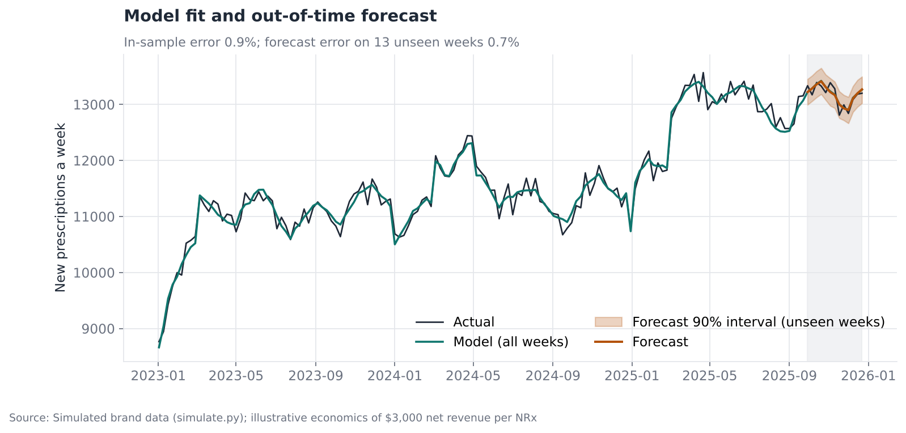
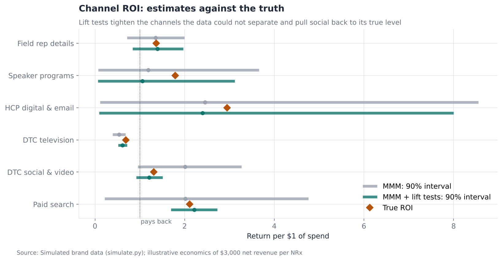
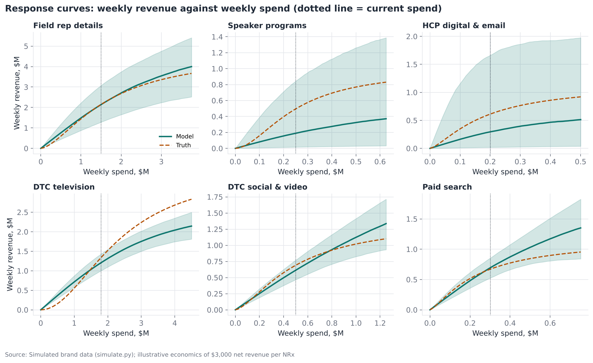
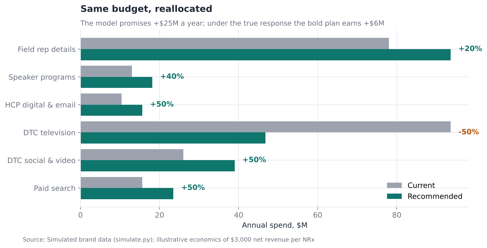

# Marketing Mix Model for a Diabetes Brand

**Question:** A brand team spends about $237M a year across six channels. What
does each channel return, where should the next dollar go, and how far can the
answer be trusted?

**Answer in one line:** A Bayesian marketing mix model recovers the field
force's return almost exactly, and three lift tests correct an overstated
social return and tighten search and TV. But when the model's curves are used to move
budget, it promises $25M a year and the truth delivers $5.6M, so budget moves
should be tested before they are made.

[Full analysis notebook](analysis.ipynb) · [Source script](analysis.py) · [Model](mmm.py) · [Simulation](simulate.py) · [Briefs](outputs/briefs/)

---

## Why simulated data

No company publishes weekly spend by channel, so marketing mix work cannot be
shown on public data. `simulate.py` builds a brand with weekly new
prescriptions (NRx) and spend for ten US regions over 156 weeks. It includes
seasonality, a competitor launch, a formulary win at a large PBM, and six
channels with known true carry-over and diminishing returns. Because the truth
is known, every estimate can be graded. Economics are illustrative: $3,000 of
net revenue per new prescription.

**Terms used below**

- **Adstock (carry-over):** part of this week's promotion keeps working in later weeks. Geometric adstock keeps a fixed share, the decay rate, each week.
- **Saturation:** diminishing returns, so each extra dollar adds less than the last.
- **ROI:** incremental net revenue per dollar spent. 1.0 means the channel pays back.
- **Marginal ROI (mROI):** the return on the *next* dollar, which is what budget decisions should use.
- **Bayesian model:** every unknown has a probability distribution, which is updated by the data. Results come as ranges, not single numbers.
- **NUTS:** the No-U-Turn Sampler, the standard algorithm for drawing from a Bayesian model's posterior.
- **r_hat:** agreement between independent sampling chains; at or below 1.01 is good.
- **Credible interval:** the range that contains the true value with a stated probability, given the model and data.
- **Lift test (geo experiment):** switch a channel off or up in some regions and compare with control regions (the method in project 07).

---

## Findings

### 1. A quick regression gets the answer badly wrong

Ordinary least squares on this week's spend, with seasonality and events but no
carry-over or saturation, puts the field force at an ROI of 0.54 (true 1.37),
TV at 0.21 (true 0.69), and gives HCP digital a negative return.

### 2. The Bayesian model fits, and forecasts weeks it has not seen



The model (PyMC, four chains) learns each channel's decay rate, saturation
curve and effect size, with a separate baseline for each region.

- In-sample R² 0.98, error 0.9%. Maximum r_hat 1.004; 9 divergent transitions out of 4,000 draws.
- Refitted on the first 143 weeks, it forecasts the last 13 with 0.7% error, and all 13 weeks fall inside its 90% interval.
- Promotion drives about 15% of new prescriptions. The rest would happen anyway.

### 3. ROI against the truth, before and after lift tests



| Channel | Annual spend | True ROI | Naive OLS | MMM | MMM + lift tests (90% interval) |
|---|---|---|---|---|---|
| Field rep details | $78.0M | 1.37 | 0.54 | 1.35 | 1.39 (0.84–1.97) |
| Speaker programs | $13.0M | 1.79 | 0.07 | 1.19 | 1.06 (0.06–3.12) |
| HCP digital & email | $10.4M | 2.95 | −2.31 | 2.45 | 2.40 (0.09–8.00) |
| DTC television | $93.6M | 0.69 | 0.21 | 0.53 | 0.61 (0.52–0.72) |
| DTC social & video | $26.0M | 1.31 | 2.64 | 2.01 | 1.21 (0.92–1.51) |
| Paid search | $15.7M | 2.11 | 1.09 | 2.02 | 2.21 (1.70–2.73) |

- The field force is recovered almost exactly.
- **DTC social** was overstated (2.01) because its bursts follow TV flights. One lift test pulls it back to 1.21 and cuts the interval width by three-quarters.
- **Paid search**'s interval shrinks from 4.5 to 1.0 points wide with one lift test.
- Speaker programs and HCP digital stay uncertain. They are small budgets that barely move, so only an experiment on them would help.
- After calibration the true ROI sits inside the 90% interval for all six channels (five of six before).

### 4. Average return is not marginal return



| Channel | Model mROI | True mROI |
|---|---|---|
| Field rep details | 1.19 | 1.23 |
| Speaker programs | 0.62 | 1.77 |
| HCP digital & email | 0.97 | 1.97 |
| DTC television | 0.55 | 0.93 |
| DTC social & video | 1.14 | 1.03 |
| Paid search | 1.98 | 1.23 |

The model is right at the margin for the field force and social, and wrong
for speaker programs, HCP digital and TV. These are the gaps an optimiser will
exploit.

### 5. The optimiser overpromises, and why



The same total budget is reallocated to maximise expected revenue, averaged
over the posterior draws. The field force can move ±20%; other channels stay
within 50–150% of today (bold) or 80–120% (cautious).

| Plan | Model's promised gain, $M a year (90% interval) | True gain, $M a year |
|---|---|---|
| Bold | 25.3 (11.1–40.3) | 5.6 |
| Cautious | 13.7 (4.6–20.9) | 1.2 |
| Best possible with the true curves | n/a | 8.2 |

Neither true gain falls inside the model's interval. Two errors drive this:

- **TV's true response is S-shaped.** It needs a minimum weight before it works, and the model's saturation curve cannot bend that way. The model undervalues TV's next dollar, so both plans cut TV.
- **Speaker programs' marginal return is underestimated** by about two-thirds, and the cautious plan cuts them, which is the wrong direction.

The bold plan's moves mostly point the right way, and it earns about two-thirds
of what was available. What it gets wrong is the size of the prize, by more
than four times. The cautious plan is not safer in proportion: it keeps the same wrong
directions and simply moves less.

---

## Recommendations

1. **Never ship an MMM budget plan as a forecast of gain.** Treat it as a ranked list of hypotheses.
2. **Test the largest moves and any move in a wide-interval channel** with a geo experiment before making it. Here that means a TV weight test and a speaker-program holdout.
3. **Feed every lift test back into the model** as a calibration term. One test per channel was enough to fix social and search.
4. **Choose curve shapes deliberately.** A channel with a threshold, like TV, needs an S-shaped (Hill) curve, or the optimiser will cut it below the level where it works.

## Limitations

- The data is simulated. The results grade the method; the channel ROIs are not estimates for any real brand.
- The simulated truth uses Hill curves and the model a simpler concave saturation curve, so the model is wrong in a realistic way. A model with the true curve family would do better on TV.
- Competitor spend is not observed, as in real life; its effect sits in the event terms.

## Reproduce

```bash
pip install -r ../requirements.txt
python analysis.py        # about 30 minutes on two CPU cores (three model fits)
```
