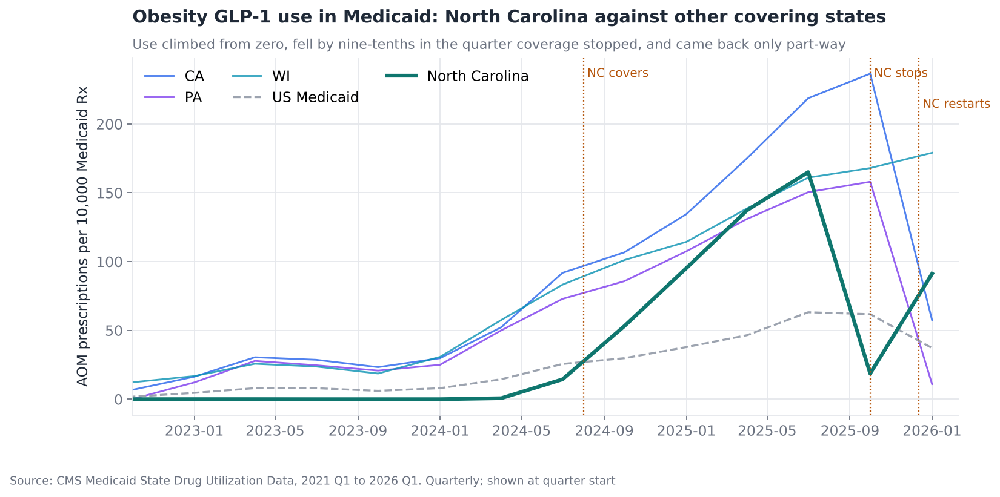
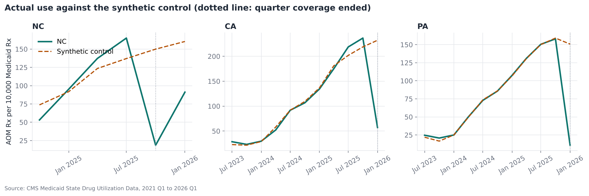
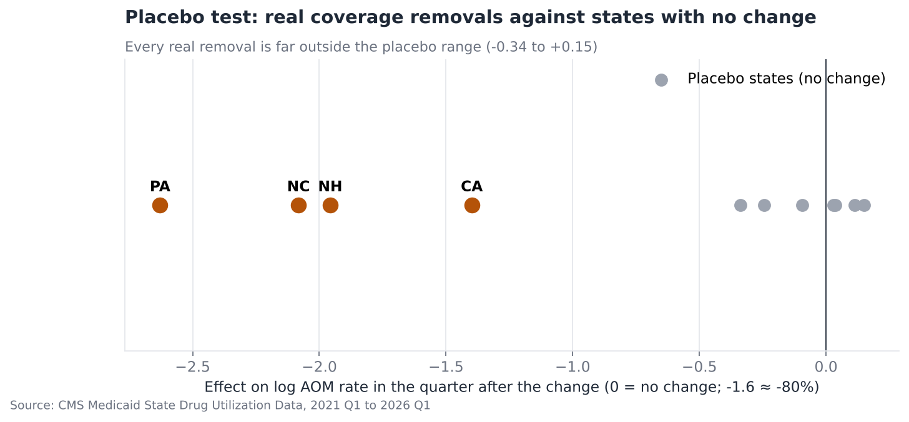
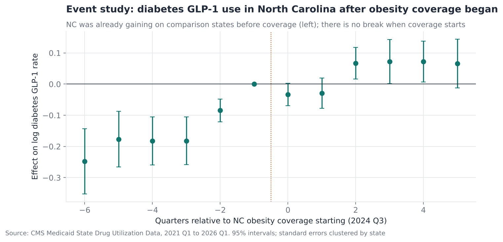
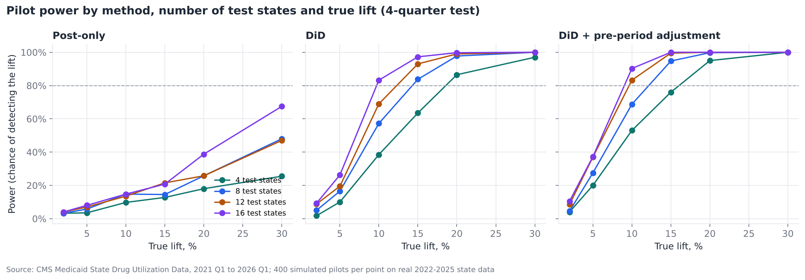
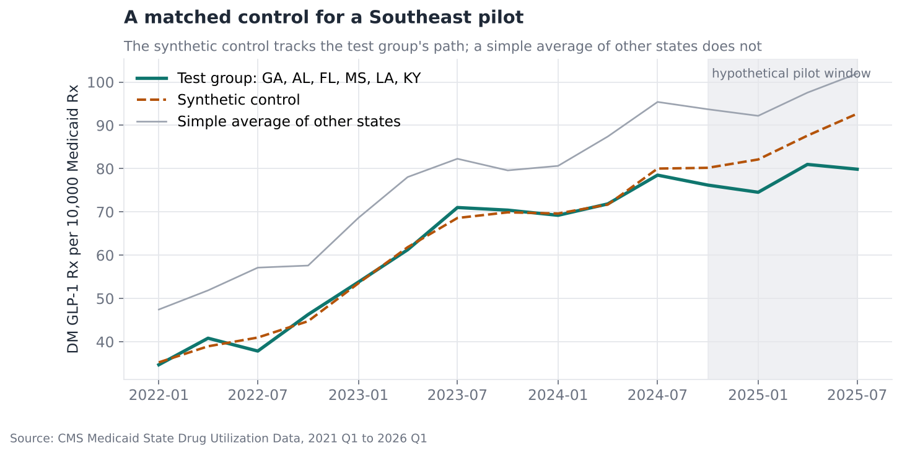

# Test and Control: What Happens When Medicaid Covers, Drops and Restores Obesity Drugs

**Questions:** North Carolina Medicaid started covering GLP-1 drugs for weight
management in August 2024, stopped in October 2025 during a budget stalemate,
and restarted in December 2025. California, Pennsylvania and New Hampshire
ended similar coverage around January 2026. How much use does coverage create,
how much disappears when it stops, and does it come back? Then, using the same
data: how should a brand team size and read a state-level pilot?

**Answer in one line:** Ending coverage removed 75–93% of expected obesity
GLP-1 use within a quarter in all four states. North Carolina got back only 57%
in its first full quarter after restarting. For pilots, a post-period
comparison cannot detect even a 30% lift; a difference-in-differences design
with pre-period adjustment detects 10% with 12 test states.

[Full analysis notebook](analysis.ipynb) · [Source script](analysis.py) · [Panel builder](panel.py) · [Briefs](outputs/briefs/)

---

## Data

**Medicaid State Drug Utilization Data (SDUD)**, every state, 2021 Q1 to 2026
Q1: prescriptions and reimbursement for each GLP-1 product, plus total
prescriptions for all drugs in each state and quarter.

Use is measured as **prescriptions per 10,000 Medicaid prescriptions of any
drug**. Dividing by all prescriptions corrects for state size and for the
newest quarter being incomplete when first published, without needing separate
enrolment data.

**Terms used below**

- **AOM:** anti-obesity medicines (Wegovy, Zepbound, Saxenda). **DM GLP-1:** the same class labelled for type 2 diabetes (Ozempic, Mounjaro, Trulicity and others).
- **Test and control:** compare places that got a change with similar places that did not. The control shows what would have happened anyway, the **counterfactual**.
- **Natural experiment:** a change made for reasons unrelated to the outcome (here, budget disputes), which can be analysed like a planned test.
- **Synthetic control:** a weighted blend of control states, chosen so that it tracks the test state before the change. Its path afterwards is the counterfactual.
- **Difference-in-differences (DiD):** the change in the test group minus the change in the control group over the same period.
- **Placebo test:** pretend a control state was treated, run the same method, and see how big an "effect" appears by chance.
- **Event study:** a regression with state and quarter fixed effects plus a coefficient for each quarter before and after a change, to show the timing of any effect.
- **Power:** the chance a test detects a real effect of a given size. **Minimum detectable effect (MDE):** the smallest effect detected 80% of the time.
- **CUPED-style adjustment:** using each unit's own pre-period behaviour as a covariate to reduce noise, as in online experimentation.

---

## Findings

### 1. North Carolina: on, off, on



North Carolina's obesity GLP-1 rate reached 165.1 per 10,000 prescriptions in
2025 Q3, the last full covered quarter, and fell to 18.7 in 2025 Q4.
Medicaid reimbursed $335M for these drugs over the five covered quarters
(gross, before rebates).

### 2. Ending coverage removes most use, in every state that did it



| State | Quarter coverage ended | Drop vs synthetic control | Drop vs DiD | Prescriptions lost in that quarter |
|---|---|---|---|---|
| North Carolina | 2025 Q4 | −88% | −89% | 72,800 |
| California | 2026 Q1 | −75% | −74% | 386,800 |
| Pennsylvania | 2026 Q1 | −93% | −93% | 74,700 |
| New Hampshire | 2026 Q1 | −86% | −85% | 3,800 |

The two methods agree within two points. The synthetic control is fitted on
log rates with the pre-period mean removed, so California, which uses more than
any donor state, can still be matched on its growth path. What remains is use
for indications Medicaid still covers through prior authorisation (Wegovy for
cardiovascular risk, Zepbound for sleep apnoea).

**Is it real?** Placebo "effects" in donor states range from −34% to +15%,
far from drops of 75–93%.



### 3. Restarting is not the same as never stopping

In 2026 Q1, its first full quarter with coverage back, North Carolina reached
91 per 10,000 against a synthetic counterfactual of 160: **57% recovered**.
A ten-week gap left more than 40% of expected volume missing a full quarter
*after* coverage came back, because patients had to get new prior
authorisations, re-start at low doses or had moved on.

### 4. Covering obesity drugs did not shift diabetes GLP-1 use



North Carolina's diabetes GLP-1 rate was already catching up with other states
before obesity coverage, which breaks the parallel-trends assumption a plain
DiD needs. Giving NC its own trend and testing only for a break when coverage
started gives a break of −1.8% (95% interval −5.9% to +2.4%). There is no
evidence of substitution in either direction.

### 5. Designing a pilot: the analysis method matters more than the sample



Real 2022–2025 state data, with no test running, is used as the noise. Random
"test" states get a known lift for four quarters; each method's detection rate
over 400 simulated pilots gives its power.

| Smallest lift detected 80% of the time | 4 states | 8 states | 12 states | 16 states |
|---|---|---|---|---|
| Post-only comparison | not reached at 30% | not reached | not reached | not reached |
| Difference-in-differences | 20% | 15% | 15% | 10% |
| DiD + pre-period adjustment | 20% | 15% | **10%** | 10% |

States differ so much in level that a post-period dashboard comparison cannot
see a 30% lift even with 16 test states. Looking at change instead of level
does most of the work; adjusting for each state's own pre-trend helps further.
When the test states are fixed in advance, a synthetic control for the group
tracks the pre-period within 3.3% (log RMSE 0.033).



---

## Recommendations

1. **For manufacturers of obesity GLP-1s:** treat Medicaid obesity coverage as fragile and model the cost of a gap, not just its length. A gap of ten weeks cost more than 40% of the next quarter's volume in North Carolina.
2. **For state budget planning:** coverage decisions move use almost one-for-one with the policy, so forecasts can be built from the covered-quarter run rate.
3. **For any regional commercial pilot:** never read a result from a post-period comparison. Pre-register a DiD with pre-period adjustment, size it with a simulation on the KPI's own history, and plan for at least 12 test states if the expected lift is around 10%.

## Limitations

- SDUD suppresses counts under 11, and those rows are dropped, so small states are slightly under-counted.
- The newest quarter in SDUD is often revised upwards. Rates per 10,000 prescriptions reduce but do not remove that.
- South Carolina also ended coverage, but its volumes were too small for a stable synthetic control.
- With seven usable placebo states the smallest possible permutation p-value is 0.125. The size of the gap, not the p-value, is the evidence.
- The pilot simulation adds a uniform lift. Real programmes have effects that vary by state and build up over time, which lowers power.

## Reproduce

```bash
pip install -r ../requirements.txt
python fetch_data.py      # SDUD for 2021-2026 (about 20 minutes)
python analysis.py
```
